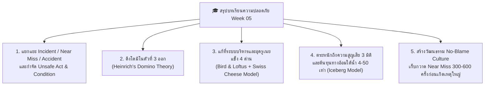

# สรุปการเรียนรู้และข้อคิดสะท้อนประจำสัปดาห์ที่ 5 (Week 05-6 Summary & Reflection)

## 📝 บทสรุปองค์ความรู้ประจำสัปดาห์ (Executive Summary)

จากการศึกษาและฝึกวิเคราะห์กรณีศึกษาในสัปดาห์ที่ 5 เรื่อง **พื้นฐานการป้องกันอุบัติเหตุ (Basics of Accident Prevention)** สามารถสรุปแก่นความรู้สำคัญเพื่อนำไปประยุกต์ใช้ในการทำงานจริงได้ 5 ประการ ดังนี้:

---

## 🌐 สรุปการเชื่อมโยง 5 แก่นทฤษฎีสู่การปฏิบัติจริง

| หัวข้อการเรียนรู้ | แก่นแนวคิดและทฤษฎีสำคัญ | สุภาษิตเตือนใจด้านความปลอดภัย | การนำไปประยุกต์ใช้หน้างานจริง |
| :--- | :--- | :--- | :--- |
| **1. คำนิยามและพีระมิดอุบัติเหตุ** | ทุกๆ 1 อุบัติเหตุร้ายแรง มี **Near Miss** เป็นสัญญาณเตือนล่วงหน้าถึง 300–600 ครั้ง (Heinrich 1:29:300 & Bird 1:10:30:600) | 🇬🇧 *"An ounce of prevention is worth a pound of cure."* (การป้องกันเพียงหนึ่งออนซ์ มีค่ามากกว่าการรักษาถึงหนึ่งปอนด์) | ไม่มองข้ามเหตุการณ์เฉียดอันตรายเล็กๆ น้อยๆ และรีบแก้ไขทันทีก่อนที่จะลุกลามไปสู่ยอดพีระมิด |
| **2. ทฤษฎีโดมิโนของไฮน์ริช** | อุบัติเหตุเกิดจากปฏิกิริยาลูกโซ่ 5 ตัว โดยมีโดมิโนตัวที่ 3 (**Unsafe Act / Unsafe Condition**) เป็นสาเหตุทางตรง | 🇯🇵 *"転ばぬ先の杖"* (ยื่นไม้เท้าพยุงตัวไว้ล่วงหน้า ก่อนที่จะลื่นไถลหกล้มลงไป) | ตัดวงจรลูกโซ่โดยการดึงโดมิโนตัวที่ 3 ออก เช่น ทำ LOTO ติดตั้งการ์ดเครื่องจักร และสวมใส่ PPE |
| **3. ทฤษฎี Bird & Loftus และ Swiss Cheese Model** | พฤติกรรมเสี่ยงหน้างานมักมีรากเหง้ามาจาก **การขาดการควบคุมของฝ่ายบริหาร (Lack of Control)** และรูรั่วเชิงระบบ (**Latent Conditions**) ที่เรียงตรงกัน | 🇩🇪 *"Vorsorge ist besser als Nachsorge."* (การวางแผนป้องกันระบบไว้ก่อน ดีกว่าการตามแก้ปัญหาทีหลัง) | สร้างแนวป้องกันหลายชั้น (Defense-in-Depth) ทั้งนโยบาย วิศวกรรม ขั้นตอน SOP และ PPE เพื่อไม่ให้รูเนยตรงกัน |
| **4. มิติความสูญเสียและทฤษฎีภูเขาน้ำแข็ง** | ความสูญเสียกระทบทั้ง **คน ทรัพย์สิน และสิ่งแวดล้อม** โดยต้นทุนทางอ้อมใต้น้ำ (**Indirect Costs**) สูงกว่าต้นทุนทางตรงถึง **4–50 เท่า** | 🇨🇳 *"宜未雨而绸缪，毋临渴而掘井"* (จงซ่อมหลังคาตั้งแต่แดดออก อย่ารอให้หิวน้ำแล้วค่อยขุดบ่อ) | ใช้ตัวเลขต้นทุนทางอ้อมใต้น้ำ (Downtime, ค่าปรับ, ขวัญกำลังใจ) ในการโน้มน้าวผู้บริหารให้ลงทุนด้านความปลอดภัย |
| **5. วัฒนธรรมความปลอดภัยเชิงรุก** | การส่งเสริมให้พนักงานกล้ารายงาน **Near Miss** ต้องอาศัยวัฒนธรรมองค์กรที่ไม่มุ่งโทษบุคคล (**No-Blame Culture**) | 🇹🇭 *"เปลี่ยนจาก 'วัวหายแล้วล้อมคอก' เป็น 'ล้อมคอกก่อนวัวจะหาย'"* | เปิดช่องทางแจ้งจุดเสี่ยงที่รวดเร็ว ให้รางวัลผู้แจ้งเหตุ Near Miss และพูดปลุกจิตสำนึกความปลอดภัยก่อนเริ่มงานทุกวัน |

---

## 💡 บันทึกการสะท้อนคิดส่วนบุคคล (Personal Learning Reflection)

จากการถอดบทเรียนกรณีศึกษาอุบัติเหตุไฟฟ้าแรงสูง 380V ตลอดทั้งสัปดาห์ ทำให้ตระหนักได้อย่างชัดเจนว่า **"อุบัติเหตุทุกครั้งมีราคาที่ต้องจ่ายแพงกว่าที่ตาเห็นเสมอ"** ทั้งความเจ็บปวดทางร่างกายและจิตใจของคนทำงาน ภาระของครอบครัวที่อยู่ข้างหลัง ไปจนถึงความเสียหายระดับล้านบาทขององค์กร การเรียนรู้ทฤษฎีโดมิโน โมเดลเนยแข็งสวิส และทฤษฎีภูเขาน้ำแข็ง จึงไม่ใช่เพียงกรอบวิชาการ แต่เป็นเครื่องมือสำคัญที่ช่วยให้เรามองเห็นจุดเสี่ยงล่วงหน้า กล้าที่จะหยุดพฤติกรรมเสี่ยง และร่วมกันสร้างสภาพแวดล้อมการทำงานที่ทุกคนสามารถกลับบ้านไปหาครอบครัวได้อย่างปลอดภัยในทุกๆ วัน

> ⭐️ **คติประจำใจด้านความปลอดภัย:**  
> *"Safety is not a gadget, but a state of mind — ความปลอดภัยไม่ได้เริ่มต้นที่อุปกรณ์เซฟตี้ราคาแพง แต่เริ่มต้นที่ความไม่ประมาทและความใส่ใจในชีวิตของทุกคน"*
