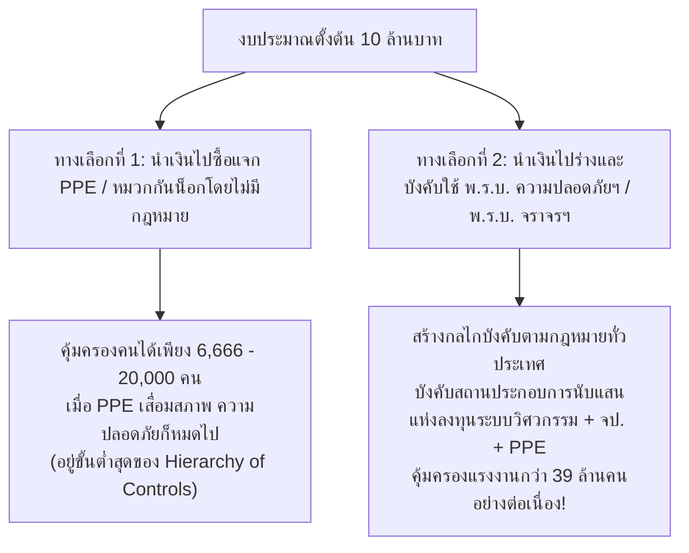

# แบบฝึกหัดและการบ้านประจำสัปดาห์ที่ 6-01: มาตรการป้องกันอุบัติเหตุ (Accident Prevention Measures)

---

## ส่วนที่ 1: แบบฝึกหัดทดสอบความเข้าใจ (Self-Assessment Questions)

**ข้อ 1: ตามหลักการ Hierarchy of Controls มาตรการใดมีประสิทธิภาพในการป้องกันอุบัติเหตุสูงสุด?**
* **คำตอบ:** **3. การยกเลิกการทำงานอันตรายนั้น (Elimination)**
* **เหตุผลสนับสนุน:** ตามลำดับชั้นการควบคุมอันตราย (Hierarchy of Controls) การขจัดอันตรายออกจากกระบวนการทำงานตั้งแต่ขั้นตอนการออกแบบ (Elimination) มีประสิทธิผลสูงสุด 100% เพราะทำให้อันตรายหมดไปจากพื้นที่โดยไม่ต้องพึ่งพาวินัยหรือความระมัดระวังของตัวบุคคล

**ข้อ 2: วัตถุประสงค์หลักของการใช้เทคนิค "5 Whys Analysis" ในการสอบสวนอุบัติเหตุคืออะไร?**
* **คำตอบ:** **3. เจาะลึกไปถึงรากของปัญหา (Root Cause) เพื่อป้องกันไม่ให้เกิดซ้ำ**
* **เหตุผลสนับสนุน:** เทคนิค 5 Whys มุ่งเน้นการถามไล่เรียงจากสาเหตุทางตรง (Immediate Cause) ลึกลงไปจนถึงข้อบกพร่องของระบบการบริหารจัดการ (Management System Failure) เพื่อกำหนดมาตรการแก้ไขและป้องกัน (CAPA) ไม่ให้เกิดอุบัติเหตุซ้ำรอยเดิม ไม่ใช่การหาตัวบุคคลมาลงโทษ (Finding Fault)

**ข้อ 3: กรณีศึกษาของ Alcoa ภายใต้การนำของพอล โอเนีลล์ พิสูจน์ให้เห็นถึงหลักการสำคัญข้อใด?**
* **คำตอบ:** **3. ความปลอดภัยสามารถขับเคลื่อนนวัตกรรมและสร้างกำไรได้จริง (Safety as a Strategic Habit)**
* **เหตุผลสนับสนุน:** เมื่อผู้บริหารระดับสูงมี Leadership Commitment ยกให้ความปลอดภัยเป็นเป้าหมายอันดับหนึ่งและขับเคลื่อนผ่านวงจร PDCA จะช่วยให้การสื่อสารในองค์กรโปร่งใส ลดข้อผิดพลาดในกระบวนการผลิต ลด Downtime และส่งผลให้ทั้งคุณภาพสินค้าและผลกำไรขององค์กรเติบโตขึ้นอย่างยั่งยืน

---

## ส่วนที่ 2: การบ้านค้นคว้าเพิ่มเติม
### หัวข้อ: การเปรียบเทียบงบประมาณในการร่างกฎหมายด้านความปลอดภัย กับ ค่าใช้จ่ายในการจัดซื้ออุปกรณ์ PPE หมวกนิรภัย เครื่องมือกู้ชีพ และการสร้างโรงพยาบาล

> **โจทย์วิเคราะห์:** ค้นคว้าและวิเคราะห์เปรียบเทียบงบประมาณที่ใช้ในกระบวนการร่างพระราชบัญญัติ (เช่น พ.ร.บ. ความปลอดภัย อาชีวอนามัย และสภาพแวดล้อมในการทำงาน หรือ พ.ร.บ. จราจรทางบก) เทียบกับต้นทุนการจัดซื้ออุปกรณ์คุ้มครองความปลอดภัยส่วนบุคคล (PPE) หมวกนิรภัย เครื่องมือกู้ชีพ หรือการสร้างโรงพยาบาล พร้อมวิเคราะห์ความคุ้มค่าเชิงเศรษฐศาสตร์และลำดับชั้นการควบคุมอันตราย (Hierarchy of Controls)

---

### 1. โครงสร้างงบประมาณในการร่างและตรากฎหมายความปลอดภัย 1 ฉบับ

ในกระบวนการนิติบัญญัติของประเทศไทย การยกร่างพระราชบัญญัติ 1 ฉบับ (เช่น **พ.ร.บ. ความปลอดภัย อาชีวอนามัย และสภาพแวดล้อมในการทำงาน พ.ศ. 2554** หรือการแก้ไขเพิ่มเติม **พ.ร.บ. จราจรทางบก**) มีกรอบค่าใช้จ่ายภาครัฐตั้งแต่ชั้นยกร่าง รับฟังความคิดเห็นตามมาตรา 77 ของรัฐธรรมนูญ จนถึงชั้นคณะกรรมาธิการรัฐสภา โดยประมาณการค่าใช้จ่ายรวมอยู่ที่ **ประมาณ 5 – 15 ล้านบาทต่อฉบับ** ดังรายละเอียดต่อไปนี้:

| ขั้นตอนกระบวนการร่างกฎหมาย | รายละเอียดค่าใช้จ่าย | งบประมาณโดยประมาณ (บาท) |
| :--- | :--- | :---: |
| **1. การศึกษาวิจัยและยกร่างกฎหมายเบื้องต้น** | จ้างที่ปรึกษาทางวิชาการ/สถาบันอุดมศึกษา ศึกษาเปรียบเทียบกฎหมายสากล (OSHA / ILO) และยกร่างตัวบท | 1,500,000 – 3,000,000 |
| **2. การรับฟังความคิดเห็นผู้มีส่วนได้เสีย (Public Hearing)** | จัดสัมมนารับฟังความคิดเห็นนายจ้าง ลูกจ้าง จป. และประชาชน 4 ภูมิภาค และระบบรับฟังออนไลน์ | 1,500,000 – 3,500,000 |
| **3. การวิเคราะห์ผลกระทบในการออกกฎหมาย (RIA)** | จัดทำรายงานการวิเคราะห์ผลกระทบที่อาจเกิดขึ้นจากกฎหมาย (Regulatory Impact Assessment) | 500,000 – 1,500,000 |
| **4. เบี้ยประชุมคณะกรรมการกฤษฎีกาและกรรมาธิการรัฐสภา** | ค่าเบี้ยประชุมคณะกรรมการตรวจร่างกฎหมาย และคณะกรรมาธิการวิสามัญพิจารณาร่าง พ.ร.บ. (ส.ส. และ ส.ว.) | 1,500,000 – 5,000,000 |
| **5. การจัดพิมพ์ เผยแพร่ และจัดทำอนุบัญญัติ/กฎกระทรวง** | ค่าเอกสาร ประชาสัมพันธ์กฎหมายใหม่ และยกร่างกฎกระทรวงที่เกี่ยวข้อง | 500,000 – 2,000,000 |
| **รวมงบประมาณในการร่างกฎหมาย 1 ฉบับ (ค่าเฉลี่ย)** | **ครอบคลุมตั้งแต่เริ่มต้นยกร่างจนประกาศในราชกิจจานุเบกษา** | **ประมาณ 10,000,000 บาท** |

---

### 2. การเปรียบเทียบมูลค่า: งบร่างกฎหมาย 10 ล้านบาท ซื้ออุปกรณ์ PPE / กู้ชีพ / โรงพยาบาลได้เท่าใด?

หากนำงบประมาณในการร่างกฎหมาย **10,000,000 บาท (10 ล้านบาท)** มาเปรียบเทียบอำนาจซื้อ (Purchasing Power) กับการจัดหาอุปกรณ์ป้องกันส่วนบุคคล (PPE) อุปกรณ์ความปลอดภัยทางถนน และโครงสร้างพื้นฐานทางการแพทย์ จะได้สัดส่วนดังตารางต่อไปนี้:

| รายการเปรียบเทียบ | ราคาต่อหน่วยโดยเฉลี่ย | จำนวนที่ได้จากงบ 10 ล้านบาท | ขอบเขตการคุ้มครอง / ข้อจำกัด |
| :--- | :---: | :---: | :--- |
| **1. ชุด PPE พื้นฐานในโรงงาน** *(หมวกนิรภัย + แว่นตาเซฟตี้ + รองเท้าหัวเหล็ก + ถุงมือ)* | 1,500 บาท / ชุด | **6,666 ชุด** *(คุ้มครองแรงงานได้ 6,666 คน)* | คุ้มครองได้เพียง 0.017% ของแรงงานในระบบทั่วประเทศ (จากแรงงานกว่า 39 ล้านคน) และมีอายุการใช้งานเพียง 1–2 ปี |
| **2. หมวกนิรภัยมาตรฐาน มอก.** *(เปรียบเทียบกับงบร่าง พ.ร.บ. จราจรทางบก)* | 500 บาท / ใบ | **20,000 ใบ** | แจกจ่ายผู้ขับขี่รถจักรยานยนต์ได้เพียง 20,000 คัน (จากรถจักรยานยนต์จดทะเบียนทั่วประเทศกว่า 22 ล้านคัน หรือคิดเป็น 0.09%) |
| **3. เครื่องกระตุกหัวใจไฟฟ้าอัตโนมัติ (AED)** *(เครื่องมือช่วยชีวิตฉุกเฉิน)* | 65,000 บาท / เครื่อง | **153 เครื่อง** | ติดตั้งในพื้นที่สาธารณะหรือโรงงานได้เพียง 153 จุด และเป็นการใช้แก้ปัญหาปลายเหตุหลังจากเกิดภาวะหัวใจหยุดเต้นแล้ว |
| **4. รถพยาบาลฉุกเฉินขั้นสูง (ALS Ambulance)** *(พร้อมอุปกรณ์กู้ชีพครบชุด)* | 2,500,000 บาท / คัน | **4 คัน** | ให้บริการรับ-ส่งผู้บาดเจ็บหลังเกิดอุบัติเหตุได้เพียง 4 พื้นที่อำเภอ |
| **5. การก่อสร้างโรงพยาบาลชุมชนขนาดเล็ก (30 เตียง)** | 150,000,000 บาท / แห่ง | **ได้เพียง 6.6% ของโรงพยาบาล 1 แห่ง** *(สร้างได้เพียงห้องฉุกเฉิน 1 ห้อง)* | งบร่างกฎหมาย 10 ล้านบาท ไม่เพียงพอแม้แต่จะสร้างอาคารผู้ป่วยใน 1 หลัง |

---

### 3. การวิเคราะห์เชิงลึกทางวิศวกรรมความปลอดภัยและเศรษฐศาสตร์ (OHS & Economic Analysis)

จากการเปรียบเทียบข้างต้น สามารถสรุปบทเรียนสำคัญเชื่อมโยงกับเนื้อหาวิชาอาชีวอนามัยและความปลอดภัยได้ 3 มิติ ดังนี้:

1. **ผลทวีคูณทางเศรษฐศาสตร์และกลไกการบังคับใช้ (Leverage Effect of Legislation):**
   * หากรัฐนำเงิน 10 ล้านบาทไปซื้อชุด PPE แจกโดยตรง รัฐจะปกป้องแรงงานได้เพียง **6,666 คน** และเมื่อครบ 1-2 ปี อุปกรณ์เสื่อมสภาพก็ต้องตั้งงบซื้อใหม่ไม่รู้จบ
   * แต่การใช้งบประมาณ 10 ล้านบาทในการตรากฎหมาย **พ.ร.บ. ความปลอดภัย อาชีวอนามัย และสภาพแวดล้อมในการทำงาน พ.ศ. 2554** เป็นการสร้าง **"กฎระเบียบเชิงโครงสร้าง (Systemic & Administrative Mandate)"** ที่บังคับให้นายจ้างและสถานประกอบการทั่วประเทศกว่า 400,000 แห่ง ต้องจัดสรรงบประมาณของตนเองในการติดตั้งระบบวิศวกรรมความปลอดภัย (Engineering Controls) แต่งตั้งเจ้าหน้าที่ความปลอดภัย (จป.) และจัดหา PPE ให้ลูกจ้างทุกคนตามมาตรา 22 คิดเป็นการกระตุ้นเม็ดเงินลงทุนด้านความปลอดภัยในภาคเอกชนนับ **หมื่นล้านบาทต่อปี** และคุ้มครองแรงงานได้ทั้งประเทศ
2. **การเปรียบเทียบผ่านลำดับชั้นการควบคุมอันตราย (Hierarchy of Controls):**
   * **การซื้อหมวกกันน็อก / PPE** คือปราการด่านสุดท้าย (ระดับที่ 5 - PPE) และ **การซื้อรถพยาบาล / สร้างโรงพยาบาล** คือมาตรการเชิงรับหลังเกิดอุบัติเหตุแล้ว (Reactive / Mitigation)
   * ในขณะที่ **การออกกฎหมายความปลอดภัย** เป็นการบังคับให้ทุกองค์กรต้องทำตั้งแต่การประเมินความเสี่ยง การขจัดอันตราย (Elimination) และการควบคุมทางวิศวกรรม (Engineering Controls) ซึ่งเป็นมาตรการเชิงรุก (Proactive Measures) ที่ต้นน้ำ ลดจำนวนผู้บาดเจ็บที่จะต้องถูกส่งเข้าโรงพยาบาลตั้งแต่แรก
3. **ข้อควรระวังในการใช้งบประมาณร่างกฎหมาย (Plan Implementation Gap):**
   * แม้กฎหมายจะมีผลทวีคูณสูง แต่หากกฎหมายที่ใช้งบร่างหลายล้านบาทกลายเป็นเพียง **"เสือกระดาษ"** ที่ขาดการบังคับใช้จริง ขาดการตรวจประเมิน (Check) และประชาชนหรือสถานประกอบการขาดวัฒนธรรมความปลอดภัย (Safety Culture) งบประมาณในการร่างกฎหมายนั้นก็จะสูญเปล่า ดังนั้น กฎหมายที่ดีจึงต้องเดินควบคู่ไปกับการบังคับใช้ตามวงจร **PDCA** และการปลูกฝังจิตสำนึกความปลอดภัยในระดับ **Interdependent (ดูแลซึ่งกันและกัน)** เสมอ
