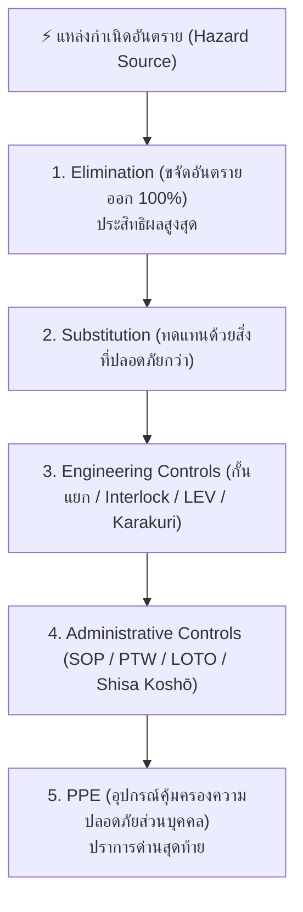

# ใบงานและสรุปการประยุกต์ใช้ Week 06-02: มาตรการป้องกันเชิงรุก (Proactive Measures & Hierarchy of Controls)

---

## 🎯 ส่วนที่ 1: สรุปกรอบแนวคิดการจัดการความเสี่ยงล่วงหน้า (Predict & Prevent)

หัวใจสำคัญของมาตรการป้องกันเชิงรุก (Proactive Measures) คือ **"การไม่ฝากชีวิตของคนทำงานไว้กับความระมัดระวังส่วนบุคคลเพียงอย่างเดียว"** แต่ต้องออกแบบปราการป้องกัน 5 ลำดับชั้น (**Hierarchy of Controls**) โดยเรียงจากมาตรการที่มีประสิทธิผลสูงสุดไปต่ำสุด ดังนี้:

---

## 🛠️ ส่วนที่ 2: กรณีศึกษาการออกแบบมาตรการเชิงรุกครบ 5 ลำดับชั้น (Case Study Application)

### สถานการณ์ปัญหาในโรงงาน:
ในแผนกเชื่อมและพ่นสีโครงสร้างเหล็กของโรงงานผลิตชิ้นส่วนเครื่องจักรกล พบปัญหาความเสี่ยงหลัก 3 ประการ ได้แก่:
1. พนักงานต้องปีนขึ้นไปพ่นสีและตรวจสอบรอยเชื่อมของโครงถังเหล็กที่ความสูง 6 เมตร
2. สีพ่นอุตสาหกรรมที่ใช้เป็นสูตรทินเนอร์ (Solvent-based) ซึ่งมีสารระเหยอินทรีย์ (VOCs) ไวไฟและเป็นพิษต่อระบบทางเดินหายใจ
3. มีรถลากชิ้นส่วน (Tugger Train) วิ่งตัดผ่านทางเดินพนักงานหน้าห้องพ่นสี และต้องมีการซ่อมบำรุงพัดลมดูดอากาศแรงดันสูงเป็นประจำ

### ตารางออกแบบมาตรการป้องกันเชิงรุกตามหลัก Hierarchy of Controls

| ลำดับชั้นการควบคุม (Control Level) | มาตรการที่ออกแบบและนำไปใช้จริงในโรงงาน | เหตุผลและผลลัพธ์ด้านความปลอดภัย |
| :--- | :--- | :--- |
| **1. Elimination (การขจัดอันตราย)** | • ยกเลิกการให้พนักงานปีนขึ้นไปตรวจสอบรอยเชื่อมบนที่สูง 6 เมตร โดยเปลี่ยนมาใช้ **โดรนติดกล้องความละเอียดสูง (Drone Inspection)** และใช้ **แขนกลพ่นสีอัตโนมัติ (Robotic Spraying)** สำหรับชิ้นงานทรงสูง | ขจัดความเสี่ยงจากการพลัดตกจากที่สูงของพนักงานออกไปได้อย่างถาวร 100% |
| **2. Substitution (การทดแทน)** | • เปลี่ยนจากสีพ่นสูตรตัวทำละลายทินเนอร์ (Solvent-based Paint) มาใช้ **สีพ่นอุตสาหกรรมสูตรน้ำ (Water-based Paint)** และน้ำยาทำความสะอาดสูตรน้ำแทน | ลดความเสี่ยงจากไอระเหยสารเคมีพิษ (VOCs) และลดความเสี่ยงการเกิดเพลิงไหม้หรือการระเบิดในห้องพ่นสีตั้งแต่ต้นทาง |
| **3. Engineering Controls (มาตรการทางวิศวกรรม)** | • ติดตั้ง **ระบบระบายอากาศเฉพาะที่ (Local Exhaust Ventilation: LEV)** ดูดละอองสี ณ จุดพ่น • ติดตั้ง **Safety Interlock** ที่ประตูห้องพ่นสีอัตโนมัติ ให้แขนกลหยุดทำงานทันทีเมื่อประตูถูกเปิดออก • ประยุกต์ใช้กลไก **Karakuri Kaizen** ใช้รางลูกกลิ้งแรงโน้มถ่วงและคานถ่วงน้ำหนักช่วยเลื่อนชิ้นงานเหล็กเข้า-ออกโดยไม่ต้องใช้มอเตอร์ไฟฟ้าและไม่ต้องยกของหนัก • ติดตั้ง **ประตูกั้นทางเดินแบบดึงเข้าหาตัว (Pull-inward Gate)** กั้นก่อนออกสู่เลนรถลาก | แยกคนออกจากอันตรายด้วยระบบกลไกและเซนเซอร์อัตโนมัติ ลดภาระการยกของหนักตามหลักการยศาสตร์ และป้องกันคนเดินพุ่งออกไปยังเลนรถลาก |
| **4. Administrative Controls (มาตรการทางบริหารจัดการ)** | • บังคับใช้ระบบ **Permit-to-Work (PTW)** สำหรับงานเชื่อม (Hot Work Permit) และงานในที่อับอากาศ • บังคับใช้ระบบ **Lockout/Tagout (LOTO)** ตามหลัก *"1 คน 1 แม่กุญแจ"* ทุกครั้งที่ซ่อมบำรุงพัดลมดูดอากาศและแขนกล • นำหลัก **Shisa Koshō (ชี้และขาน 3 ทิศทาง: ขวา-ซ้าย-ตรงไป)** มาใช้ทุกครั้งก่อนก้าวข้ามทางตัดเลนรถลาก | สร้างระเบียบวินัย ขั้นตอนการทำงานที่ปลอดภัย (SOP) ยืนยันสถานะพลังงานเป็นศูนย์ก่อนซ่อมเครื่องจักร และกระตุ้นสติสัมปชัญญะของพนักงานขณะเดินในโรงงาน |
| **5. PPE (อุปกรณ์คุ้มครองความปลอดภัยส่วนบุคคล)** | • กำหนดให้พนักงานสวมใส่ **หน้ากากกรองอนุภาคและไอสารเคมี**, **แว่นตานิรภัยมีกระบังข้าง (ANSI Z87.1)**, **หมวกนิรภัย (ANSI Z89.1)**, และ **รองเท้านิรภัยหัวเหล็กพื้นกันลื่น** ตลอดเวลาที่อยู่ในพื้นที่ปฏิบัติงาน | เป็นปราการด่านสุดท้าย (Last Line of Defense) ช่วยลดความรุนแรงของการบาดเจ็บหากยังมีอันตรายหลุดรอดจากด่านวิศวกรรมและบริหารจัดการ |

---

## 💡 บทสรุปการเรียนรู้ประจำบท (Key Reflection)
การออกแบบความปลอดภัยเชิงรุกที่มีประสิทธิภาพ ต้องเริ่มคิดจากบนลงล่าง ($\text{Elimination} \rightarrow \text{Substitution} \rightarrow \text{Engineering} \rightarrow \text{Administrative} \rightarrow \text{PPE}$) เสมอ การลงทุนในระดับ **Engineering Controls** และ **Karakuri Kaizen** อาจมีต้นทุนเริ่มต้นในการออกแบบ แต่สามารถป้องกันอุบัติเหตุได้อย่างยั่งยืนโดยไม่ต้องกังวลว่าพนักงานจะเหนื่อยล้าหรือเผลอเรอในวันทำงาน
