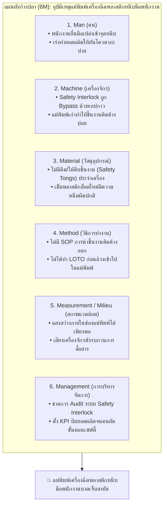

# ใบงานและกรณีศึกษาการสอบสวนอุบัติเหตุ Week 06-03: มาตรการป้องกันเชิงรับ (Reactive Measures & RCA)

---

## 🔍 ส่วนที่ 1: สถานการณ์อุบัติเหตุเพื่อการสอบสวน (Accident Case Scenario)

**เหตุการณ์:**  
เมื่อวันที่ 15 ตุลาคม เวลา 14.30 น. ณ แผนกขึ้นรูปชิ้นส่วนพลาสติก พนักงานคุมเครื่องฉีดพลาสติกชื่อ **"นายสมปอง"** พบว่ามีชิ้นงานพลาสติกติดค้างอยู่ในแม่พิมพ์ (Mold Jam) นายสมปองจึงเปิดประตูครอบนิรภัยด้านหน้าและยื่นมือขวาเข้าไปดึงชิ้นงานที่ติดออก ทันใดนั้น แม่พิมพ์ไฮดรอลิกเกิดเคลื่อนที่หนีบเข้าหากันกะทันหัน ทำให้มือขวาของนายสมปองถูกแม่พิมพ์หนีบได้รับบาดเจ็บกระดูกนิ้วมือแตกหัก ต้องนำส่งโรงพยาบาลฉุกเฉินทันที

---

## 📋 ส่วนที่ 2: การปฏิบัติตามขั้นตอนการสอบสวนอุบัติเหตุ 5 ขั้นตอน (5 Steps of Investigation)

### ขั้นที่ 1: การตอบสนองทันทีและการกั้นพื้นที่ (Immediate Response & Scene Preservation)
1. กดปุ่มหยุดฉุกเฉิน (Emergency Stop) และตัดแหล่งจ่ายพลังงานไฟฟ้า-ไฮดรอลิกของเครื่องฉีดพลาสติกหมายเลข 4 ทันที
2. ปฐมพยาบาลเบื้องต้นและนำตัวนายสมปองส่งโรงพยาบาลโดยเร็วที่สุด
3. ล้อมเทปกั้นพื้นที่เกิดเหตุ (Preserve the Scene) ห้ามเคลื่อนย้ายเครื่องจักร ชิ้นงานที่ติดค้าง หรือปรับเปลี่ยนสภาพสวิตช์หน้างานจนกว่าทีมสอบสวนจะเก็บหลักฐานเสร็จสิ้น

### ขั้นที่ 2: การรวบรวมหลักฐานตามหลัก 4Ps (Evidence Collection)
* **1. People (บุคคล):** สัมภาษณ์นายสมปองและเพื่อนร่วมงานในกะเดียวกันด้วยบรรยากาศไม่กล่าวโทษ พบว่าพนักงานมักยื่นมือเข้าไปดึงชิ้นงานที่ติดค้างออกเองเป็นประจำเพราะไม่อยากรอช่างซ่อมบำรุง
* **2. Position (ตำแหน่งและสถานที่):** ถ่ายภาพตำแหน่งจุดหนีบของแม่พิมพ์ ตำแหน่งประตูนิรภัยที่เปิดอยู่ และพบว่าแสงสว่างภายในช่องแม่พิมพ์ค่อนข้างมืด
* **3. Parts (ชิ้นส่วนอุปกรณ์):** ตรวจสอบพบว่า **สวิตช์อินเทอร์ล็อค (Safety Interlock Switch)** ที่ประตูนิรภัยถูกใช้เทปกาวพันค้างไว้และถูกถอดสายไฟบายพาส (Bypass) ออก ทำให้แม้จะเปิดประตู เครื่องฉีดก็ยังคงทำงานต่อได้ และไม่พบไม้คีบชิ้นงาน (Safety Tongs) ประจำเครื่อง
* **4. Paper (เอกสารหลักฐาน):** ตรวจสอบใบตรวจเช็กเครื่องจักรประจำวัน (Daily Checklist) พบว่ามีการติ๊กช่อง "ปกติ" ทุกวันโดยไม่ได้ตรวจสอบสวิตช์ Interlock จริง และไม่มีเอกสาร SOP ขั้นตอนการแก้ไขชิ้นงานติดค้างติดไว้ที่หน้าเครื่อง

---

### ขั้นที่ 3: การวิเคราะห์สาเหตุรากเหง้า (Root Cause Analysis: RCA)

#### 3.1 การวิเคราะห์ด้วยแผนผังก้างปลา (Fishbone Diagram - 6M Framework)

#### 3.2 การเจาะลึกสาเหตุรากเหง้าด้วย 5 Whys Analysis

* **Why ที่ 1 (Physical Cause):** ทำไมมือของนายสมปองจึงถูกแม่พิมพ์เครื่องฉีดพลาสติกหนีบ?  
  ➔ **ตอบ:** เพราะนายสมปองยื่นมือเข้าไปดึงชิ้นงานที่ติดค้างในขณะที่ระบบไฮดรอลิกของเครื่องจักรยังทำงานอยู่ และประตูนิรภัยไม่ได้ตัดการทำงานของเครื่อง
* **Why ที่ 2 (Technical Failure):** ทำไมเมื่อเปิดประตูนิรภัยออกแล้ว ระบบ Safety Interlock จึงไม่สั่งตัดการทำงานของเครื่องฉีดพลาสติก?  
  ➔ **ตอบ:** เพราะสวิตช์ Safety Interlock ที่ประตูถูกใช้เทปกาวพันกดค้างไว้ (Bypass) มาตั้งแต่อาทิตย์ที่แล้ว
* **Why ที่ 3 (Supervisor & Operational Failure):** ทำไมสวิตช์ Safety Interlock จึงถูก Bypass ทิ้งไว้โดยไม่มีการซ่อมแซม?  
  ➔ **ตอบ:** เพราะสวิตช์ตัวเดิมเริ่มหลวมทำให้เครื่องหยุดเองบ่อย ช่างกะดึกจึงทำ Bypass ชั่วคราวเพื่อให้เดินเครื่องผลิตต่อได้ทันยอดส่งมอบ และไม่มีอะไหล่สวิตช์ตัวใหม่ในคลัง
* **Why ที่ 4 (Inspection & Procedure Failure):** ทำไมการตรวจสอบเครื่องจักรประจำวัน (Daily Checklist) จึงตรวจไม่พบว่ามีการ Bypass อุปกรณ์ความปลอดภัย?  
  ➔ **ตอบ:** เพราะใบตรวจเช็กเครื่องจักรมีแต่หัวข้อตรวจการทำงานทั่วไป ไม่มีหัวข้อบังคับทดสอบฟังก์ชัน Safety Interlock ก่อนเริ่มกะ และหัวหน้างานเซ็นรับรองเอกสารโดยไม่ได้เดินตรวจหน้างานจริง
* **Why ที่ 5 (Root Cause - Management System Failure):** ทำไมระบบบริหารจัดการของโรงงานจึงปล่อยให้มีการดัดแปลงอุปกรณ์ความปลอดภัยเพื่อแลกกับยอดการผลิต?  
  ➔ **ตอบ (Root Cause):** **โรงงานขาดนโยบายและระบบควบคุมการดัดแปลงอุปกรณ์ความปลอดภัย (Defeat of Safety Devices Policy & Management of Change)** ขาดระบบการตรวจสอบเชิงรุก (Safety Audit) และมุ่งเน้นตัวชี้วัดยอดการผลิตระยะสั้นเหนือกว่ามาตรฐานความปลอดภัยของเครื่องจักร

---

### ขั้นที่ 4: การกำหนดมาตรการแก้ไขและป้องกัน (CAPA: Corrective & Preventive Actions)

| ประเภทมาตรการ | รายละเอียดการดำเนินการ (Action Items) | ผู้รับผิดชอบ / กำหนดเสร็จ |
| :--- | :--- | :---: |
| **Corrective Actions (การแก้ไขทันที)** | 1. สั่งหยุดเดินเครื่องฉีดพลาสติกหมายเลข 4 ทันทีและถอดเทปกาวที่ Bypass ออก 2. เปลี่ยนสวิตช์ Safety Interlock ตัวใหม่ที่ได้มาตรฐานทันที 3. จัดหาคีมด้ามยาว (Safety Tongs) สำหรับคีบชิ้นงานที่ติดค้างไปวางประจำเครื่องฉีดทุกเครื่อง | ฝ่ายซ่อมบำรุง & จป. (ภายใน 24 ชั่วโมง) |
| **Preventive Actions (การป้องกันการเกิดซ้ำเชิงระบบ)** | 1. เปลี่ยนสวิตช์ Interlock ทุกเครื่องเป็นแบบ **Coded Magnetic / RFID Safety Switch** ที่ไม่สามารถใช้เทปกาวหรือไขควงกดหลอก (Anti-tamper) ได้ 2. ปรับปรุงใบ Daily Checklist ให้ต้อง **ทดสอบเปิดประตูเพื่อเช็กการตัดการทำงานของ Interlock ก่อนเริ่มงานทุกกะ** 3. จัดทำ SOP และอบรมขั้นตอนการทำ **LOTO** ทุกครั้งเมื่อต้องแก้ไขชิ้นงานติดค้างในแม่พิมพ์ 4. ออกกฎเหล็กห้ามดัดแปลงหรือ Bypass อุปกรณ์เซฟตี้โดยเด็ดขาด หากเครื่องมีปัญหาให้สั่งหยุดเครื่องได้ทันทีโดยไม่หัก KPI | ผู้จัดการโรงงาน, ฝ่ายวิศวกรรม & จป. (ภายใน 15 วัน) |

---

### ขั้นที่ 5: เอกสารแจ้งเตือนความปลอดภัย (One-Page Safety Alert)

> 🚨 **SAFETY ALERT: แจ้งเตือนภัยความปลอดภัยประจำสัปดาห์**  
> **เรื่อง:** อันตรายจากการยื่นมือเข้าจุดหนีบแม่พิมพ์และการ Bypass สวิตช์นิรภัย (Safety Interlock)  
> - **สิ่งที่เกิดขึ้น:** พนักงานถูกแม่พิมพ์เครื่องฉีดพลาสติกหนีบมือขวาบาดเจ็บสาหัส ขณะยื่นมือเข้าไปดึงชิ้นงานที่ติดค้าง เนื่องจากสวิตช์ Safety Interlock ประตูนิรภัยถูกพันเทปกาว Bypass ไว้  
> - **กฎเหล็กเพื่อความปลอดภัยของทุกคน:**  
>   1. **ห้ามใช้มือเปล่า** ล้วงเข้าไปในเขตแม่พิมพ์โดยเด็ดขาด ให้ใช้คีมด้ามยาว (Safety Tongs) เท่านั้น  
>   2. **ห้ามดัดแปลง หรือพันเทปกาว Bypass** สวิตช์นิรภัยและม่านแสงทุกชนิด หากพบอุปกรณ์ชำรุดให้กดหยุดเครื่องและแจ้งหัวหน้างานทันที  
>   3. **ต้องตัดไฟและคล้องกุญแจ LOTO ทุกครั้ง** ก่อนเข้าไปแก้ไขชิ้นงานติดค้างหรือซ่อมบำรุงภายในเครื่องจักร
