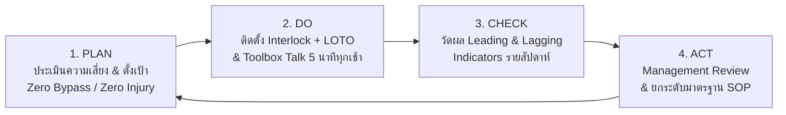

# ใบงานและแผนขับเคลื่อนวัฒนธรรมความปลอดภัย Week 06-04: การนำแผนไปใช้จริง (Plan Implementation & Safety Culture)

---

## 🔄 ส่วนที่ 1: แผนการขับเคลื่อนมาตรการความปลอดภัยสู่หน้างานจริงด้วยวงจร PDCA

เพื่อเปลี่ยนแผนงานความปลอดภัยจาก "กระดาษในแฟ้ม" ให้กลายเป็น "การปฏิบัติจริงหน้างาน" จึงกำหนดแผนการขับเคลื่อนโครงการ **"Zero Machine Entrapment & Proactive Safety Culture"** ตามวงจร **PDCA** ดังนี้:

| ขั้นตอน PDCA | กิจกรรมและแผนปฏิบัติการหลัก (Action Plan) | เครื่องมือและกลไกที่ใช้ขับเคลื่อน |
| :--- | :--- | :--- |
| **1. PLAN (วางแผน)** | • ชี้บ่งอันตรายและประเมินความเสี่ยงเครื่องจักรทุกเครื่องในโรงงาน • ตั้งเป้าหมายอุบัติเหตุจากการถูกเครื่องจักรหนีบเป็นศูนย์ (Zero Accident) • จัดสรรงบประมาณติดตั้งระบบป้องกันทางวิศวกรรมและชุดอุปกรณ์ LOTO | Risk Assessment Matrix, JSA (Job Safety Analysis), แผนงบประมาณความปลอดภัยประจำปี |
| **2. DO (ปฏิบัติ)** | • ติดตั้งฝาครอบเครื่องจักร (Machine Guard) และสวิตช์ Interlock ป้องกันการ Bypass • จัดทำกิจกรรม **Toolbox Talk 5 นาที** ก่อนเริ่มงานทุกกะ และฝึกปฏิบัติการทำ **Shisa Koshō (ชี้และขาน 3 ทิศทาง)** • บังคับใช้ระบบ **Work Permit** และ **LOTO** ในงานซ่อมบำรุง 100% | Engineering Controls, Toolbox Talk, Permit-to-Work (PTW), Lockout/Tagout |
| **3. CHECK (ตรวจสอบและวัดผล)** | • คณะกรรมการ คปอ. และผู้บริหารเดินตรวจความปลอดภัยหน้างาน (Safety Walk) ทุกสัปดาห์ • ติดตามประเมินผลทั้งตัวชี้วัดเชิงรุก (Leading Indicators) และตัวชี้วัดเชิงรับ (Lagging Indicators) | Safety Inspection Checklist, ระบบรายงาน Near-Miss, Dashboard ความปลอดภัย |
| **4. ACT (ปรับปรุงต่อเนื่อง)** | • จัดประชุมทบทวนโดยฝ่ายบริหาร (Management Review) ทุกเดือน • นำข้อมูลจากการรายงาน Near-Miss และข้อเสนอแนะของพนักงานมาปรับปรุงวิศวกรรมและ SOP อย่างต่อเนื่อง | Management Review, CAPA Tracking, Kaizen ด้านความปลอดภัย |

---

## 📊 ส่วนที่ 2: การกำหนดตัวชี้วัดผลงานความปลอดภัย (Leading vs Lagging Indicators)

เพื่อให้องค์กรสามารถตรวจจับและป้องกันปัญหาก่อนเกิดความสูญเสีย จึงกำหนดตารางวัดผลควบคู่กันทั้ง 2 มิติ (โดยเน้นน้ำหนักไปที่ตัวชี้วัดเชิงรุก 70% และเชิงรับ 30%) ดังนี้:

| ประเภทตัวชี้วัด | ตัวชี้วัด (KPIs) | เป้าหมาย (Target) | ความถี่ในการวัดผล |
| :--- | :--- | :---: | :---: |
| **🟢 Leading Indicators (ตัวชี้วัดเชิงรุก - วัดก่อนเกิดเหตุ)** | 1. อัตราการตรวจสอบการทำงานของ Safety Interlock และ Machine Guard ก่อนเริ่มกะ 2. จำนวนการรายงานเหตุการณ์เกือบเกิดอุบัติเหตุ (Near-Miss Reporting) จากพนักงาน 3. เปอร์เซ็นต์การแก้ไขจุดเสี่ยงที่พบจากการตรวจ Safety Audit ภายในกำหนดเวลา 4. อัตราการเข้าร่วมกิจกรรม Toolbox Talk 5 นาที และการอบรม LOTO ของพนักงาน | **100% ทุกกะ**  **≥ 30 เรื่อง/เดือน**  **100% ทันกำหนด**  **100% ของพนักงาน** | รายวัน  รายเดือน  รายเดือน  รายสัปดาห์ |
| **🔴 Lagging Indicators (ตัวชี้วัดเชิงรับ - วัดหลังเกิดเหตุ)** | 1. อัตราความถี่ของการบาดเจ็บถึงขั้นหยุดงาน (Lost Time Injury Frequency Rate: LTIFR) 2. จำนวนอุบัติเหตุร้ายแรงจากการทำงานกับเครื่องจักรและไฟฟ้า 3. มูลค่าความสูญเสียทางตรงและทางอ้อมจากอุบัติเหตุในโรงงาน | **0 ครั้ง**  **0 ครั้ง** **0 บาท** | รายเดือน / รายปี |

---

## 🏆 ส่วนที่ 3: แผนยกระดับวัฒนธรรมความปลอดภัยตาม Bradley Curve (สู่ระดับ Interdependent)

การนำแผนไปใช้จะยั่งยืนได้เมื่อองค์กรก้าวข้ามจากระดับที่ทำเพราะกลัวถูกลงโทษ (**Reactive**) หรือทำเฉพาะตอนมี จป. เฝ้าดู (**Dependent**) ไปสู่ระดับที่ดูแลตัวเอง (**Independent**) และสูงสุดคือระดับที่ทุกคนดูแลซึ่งกันและกัน (**Interdependent**) ผ่าน 3 ปัจจัยความสำเร็จหลัก ดังนี้:

1. **ความมุ่งมั่นของผู้นำ (Leadership & Management Commitment):**
   * ผู้บริหารระดับสูงและผู้จัดการโรงงานต้องสวมใส่อุปกรณ์ PPE ครบถ้วนทุกครั้งที่เดินเข้าพื้นที่ผลิตเพื่อเป็นแบบอย่างที่ดี (Walk the Talk)
   * ประกาศจุดยืนชัดเจนแบบกรณีศึกษาของ **Alcoa (Paul O'Neill)** ว่า *"พนักงานทุกคนมีสิทธิ์กดหยุดเครื่องจักรได้ทันทีหากพบสภาพงานที่ไม่ปลอดภัย โดยที่ผู้บริหารจะปกป้องและไม่ตำหนิเรื่องยอดผลิต"*
2. **การมีส่วนร่วมของพนักงาน (Employee Engagement):**
   * ให้พนักงานหน้างานที่เป็นผู้ควบคุมเครื่องจักรตัวจริงเข้ามามีส่วนร่วมในการเขียนขั้นตอน JSA และออกแบบกลไก Karakuri หรือจุดติดตั้งการ์ดเครื่องจักรเพื่อให้ใช้งานได้จริงและไม่เกะกะการทำงาน
   * จัดตั้งแคมเปญ **"Buddy Safety Check"** ให้เพื่อนร่วมงานจับคู่ช่วยตรวจเช็กอุปกรณ์ PPE และการคล้องกุญแจ LOTO ให้กันและกันก่อนเริ่มงาน
3. **การสื่อสารที่ชัดเจนและสร้างสรรค์ (Clear & Positive Communication):**
   * เปลี่ยนคู่มือเล่มหนาเป็นป้ายภาพ **Visual One-Point Lesson** ติดไว้ที่หน้าเครื่องจักรทุกตัว
   * มอบรางวัลชมเชยพนักงานที่แจ้งเหตุ Near-Miss และพนักงานที่ช่วยเตือนสติเพื่อนร่วมงานด้วยความหวังดี เพื่อตอกย้ำว่า **"ความปลอดภัยคือคุณค่าหลัก (Core Value) ที่จะพาพวกเราทุกคนกลับบ้านไปหาครอบครัวอย่างปลอดภัยในทุกๆ วัน"**
