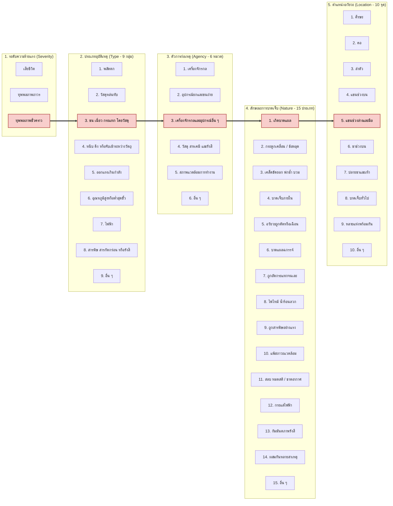

# กิจกรรม "ผิดเป็นครู" (Learning from Incidents) — การถอดรหัสอุบัติเหตุจริงตามมาตรฐาน ILO 5 มิติ

---

## 📊 แผนภาพการจำแนกอุบัติเหตุตามมาตรฐานสากล ILO 5 มิติ (ILO 5-Dimension Classification Diagram)

> **คำอธิบายแผนภาพ:** แผนภาพแสดงการลากเส้นเชื่อมโยง 5 มิติตามมาตรฐาน ILO (เหมือนรูปแบบใน `Example.md` และ `ILO Classification.svg`) ของเหตุการณ์จริงที่นำมาถอดบทเรียน:  
> **`ทุพพลภาพชั่วคราว`** $\longrightarrow$ **`3. ชน เฉี่ยว กระแทก โดยวัสดุ`** $\longrightarrow$ **`3. เครื่องจักรกลและอุปกรณ์อื่น ๆ`** $\longrightarrow$ **`1. เกิดบาดแผล`** $\longrightarrow$ **`5. แขนช่วงล่างและมือ`**

---

## 📖 โครงสร้าง 4 ส่วนในการเล่าเรื่อง (Storytelling Framework)

### ส่วนที่ 1: ปูเรื่องและบริบท (Context & Scenario)
เมื่อช่วงปิดเทอมที่ผ่านมา **"พี่ต้น"** (ลูกพี่ลูกน้องซึ่งเป็นช่างต่อเติมโครงหลังคาเหล็ก) กำลังเร่งทำงานตัดและเจียรแต่งท่อเหล็กกล่องเพื่อทำโครงหลังคาโรงจอดรถที่บ้านลูกค้าในช่วงเย็นเวลาประมาณ 17.30 น. เนื่องจากแสงสว่างเริ่มมืดลงและต้องการเร่งงานให้เสร็จทันก่อนฝนจะตก พี่ต้นจึงใช้เครื่องเจียรไฟฟ้ามือถือ (ลูกหมู 4 นิ้ว) ตัดท่อเหล็กที่วางพาดอยู่บนม้าไม้โดยไม่ได้ใช้ปากกาจับชิ้นงาน (Vise) ยึดให้แน่น และได้ถอดฝาครอบบังใบเจียร (Safety Guard) ออกเพื่อให้มองแนวตัดได้ถนัดขึ้น อีกทั้งยังใช้มือซ้ายเปลือยเปล่า (ไม่ได้สวมถุงมือหนังกันบาด) กดจับท่อเหล็กไว้ใกล้กับแนวใบเจียร จังหวะที่กดใบเจียรลงไปเกือบขาด ท่อเหล็กเกิดการบิดตัวหนีบใบเจียร ทำให้เครื่องเจียรเกิดอาการสะบัดดีดกลับ (Kickback) อย่างแรง ใบเจียรที่กำลังหมุนด้วยความเร็วสูงจึงสะบัดมาเฉือนเข้าที่บริเวณหลังมือซ้ายและโคนนิ้วโป้งซ้ายของพี่ต้นทันที เลือดไหลออกจำนวนมาก ต้องรีบปฐมพยาบาลห้ามเลือดและนำตัวส่งโรงพยาบาล แพทย์ทำการเย็บแผลรวม 9 เข็ม โชคดีที่เส้นเอ็นไม่ขาด พี่ต้นต้องหยุดพักงานเพื่อรักษาแผลเป็นเวลา 2 สัปดาห์เต็ม ก่อนที่แผลจะสมานสนิทและสามารถกลับมาทำงานช่างได้ตามปกติ

---

### ส่วนที่ 2: ถอดรหัสตามมาตรฐานสากล ILO 5 มิติ (ILO 5-Dimension Classification)

1. **มิติที่ 1 - ระดับความร้ายแรง (Severity):**  
   👉 **`ทุพพลภาพชั่วคราว (Temporary Disablement)`**  
   *เหตุผล:* ผู้ประสบเหตุต้องหยุดงานตั้งแต่วันถัดไปเป็นเวลา 2 สัปดาห์เพื่อพักรักษาบาดแผลเย็บ 9 เข็ม และเมื่อรักษาหายแล้วสามารถกลับมาประกอบอาชีพช่างเหล็กตามเดิมได้ 100% โดยไม่มีความพิการถาวร
2. **มิติที่ 2 - ประเภทของอุบัติเหตุ (Type - 1 ใน 9 กลุ่มของ ILO):**  
   👉 **`กลุ่มที่ 3: การถูกชน เฉี่ยว กระแทก โดยวัสดุ (Stepping on, Striking Against or Struck by Objects)`**  
   *เหตุผล:* เกิดจากการที่เครื่องเจียรไฟฟ้าสะบัดดีดกลับ (Kickback) แล้วใบเจียรเคลื่อนที่เข้ามาเฉี่ยวชนและกรีดกระแทกเข้าที่หลังมือของผู้ปฏิบัติงาน
3. **มิติที่ 3 - ตัวการที่ก่อให้เกิดอุบัติเหตุ (Agency - 1 ใน 6 หมวดของ ILO):**  
   👉 **`หมวดที่ 3: เครื่องจักรกลและอุปกรณ์อื่น ๆ (Other Equipment — เครื่องมือไฟฟ้าพกพา: หินเจียรมือถือ / Angle Grinder)`**  
   *เหตุผล:* หินเจียรไฟฟ้ามือถือจัดอยู่ในหมวดที่ 3 ย่อยที่ 5 (เครื่องมือไฟฟ้าต่าง ๆ - Electric Tools) ซึ่งเป็นอุปกรณ์ต้นเหตุโดยตรงที่ทำให้เกิดการบาดเจ็บ
4. **มิติที่ 4 - ลักษณะการบาดเจ็บ (Nature of Injury - 1 ใน 15 ประเภทของ ILO):**  
   👉 **`ประเภทที่ 1: เกิดบาดแผล (Open Wounds, Cuts & Punctures)`**  
   *เหตุผล:* ร่างกายได้รับบาดแผลเปิดฉีกขาดจากการถูกใบเจียรบาดลึกบริเวณผิวหนังและเนื้อเยื่อหลังมือ ต้องทำการเย็บแผล 9 เข็ม
5. **มิติที่ 5 - ตำแหน่งอวัยวะที่ได้รับบาดเจ็บ (Location of Injury - 1 ใน 10 จุดของ ILO):**  
   👉 **`กลุ่มที่ 5: แขนช่วงล่างและมือ (Lower Arm & Hand)`**  
   *เหตุผล:* ตำแหน่งที่ได้รับบาดเจ็บคือบริเวณหลังมือซ้ายและโคนนิ้วหัวแม่มือซ้าย ซึ่งอยู่ในกลุ่มที่ 5 (ข้อศอก แขนท่อนปลาย ข้อมือ ฝ่ามือ และนิ้วมือ)

---

### ส่วนที่ 3: วิเคราะห์สาเหตุที่ทำให้เกิดเหตุ (Causal Analysis)

* **การกระทำที่ไม่ปลอดภัย (Unsafe Act):**
  1. ถอดฝาครอบนิรภัยบังใบเจียร (Safety Guard) ออกจากตัวเครื่องเจียรไฟฟ้า
  2. ใช้มือซ้ายจับยึดชิ้นงานท่อเหล็กในระยะประชิดแนวใบเจียร แทนที่จะใช้อุปกรณ์จับยึดชิ้นงาน (Clamp / Vise)
  3. จับถือเครื่องเจียรด้วยมือขวาเพียงข้างเดียว (ทำให้ควบคุมแรงสะบัด Kickback ไม่ได้) และไม่สวมถุงมือหนังหรือถุงมือกันบาดขณะทำงาน
  4. เร่งรีบทำงานท่ามกลางความกดดันก่อนฝนตก
* **สภาพการณ์ที่ไม่ปลอดภัย (Unsafe Condition):**
  1. เครื่องเจียรไฟฟ้าอยู่ในสภาพไม่มีการ์ดป้องกันใบเจียร (Lack of Machine Guarding) และไม่มีด้ามจับช่วยด้านข้าง (Auxiliary Side Handle)
  2. ชิ้นงานท่อเหล็กวางพาดอยู่บนม้าไม้ชั่วคราวที่ไม่มั่นคง ทำให้ท่อเหล็กเกิดการยุบตัวและหนีบใบเจียร (Blade Pinching) ขณะตัดใกล้ขาด
  3. สภาพแสงสว่างหน้างานในช่วงเย็นเริ่มมืดสลัว ทำให้กะระยะแนวตัดได้ไม่ชัดเจน

---

### ส่วนที่ 4: ถอดบทเรียนและมาตรการป้องกันเชิงรุก (Lessons Learned & Solutions ตามหลัก Hierarchy of Controls)

หากย้อนเวลากลับไปแก้ไขและวางมาตรการป้องกันเชิงรุกเพื่อไม่ให้เกิดเหตุซ้ำ สามารถประยุกต์ใช้ **Hierarchy of Controls** ได้ดังนี้:
1. **Substitution / Engineering Controls (การทดแทนและมาตรการทางวิศวกรรม):**
   * เปลี่ยนจากการใช้หินเจียรมือถือ (Angle Grinder) มาใช้ **แท่นตัดไฟเบอร์ (Chop Saw) หรือเลื่อยสายพานตัดเหล็ก** ที่มีปากกาจับยึดชิ้นงานแน่นหนาและมีฝาครอบใบตัดในตัวแทน
   * หากจำเป็นต้องใช้หินเจียรมือถือ ต้องติดตั้ง **ฝาครอบป้องกันใบเจียร (Safety Guard)** และ **ด้ามจับด้านข้าง (Side Handle)** ให้ครบถ้วน 100% เลือกใช้เครื่องเจียรที่มีระบบ **Kickback Control / Dead-man Switch** ที่ตัดไฟทันทีเมื่อใบเจียรติดขัด และใช้ **ปากกาจับชิ้นงาน (C-Clamp / Bench Vise)** ยึดท่อเหล็กเข้ากับโต๊ะงานแทนการใช้มือจับเสมอ
2. **Administrative Controls (มาตรการทางบริหารจัดการ):**
   * กำหนดขั้นตอนการปฏิบัติงานปลอดภัย (SOP) ให้จับเครื่องเจียรด้วย **สองมือเสมอ** และจัดวางจุดรองรับชิ้นงานให้ท่อเหล็กฝั่งที่ถูกตัดตกลงได้อย่างอิสระ ไม่บีบหนีบใบเจียร
   * จัดเตรียมไฟส่องสว่างสปอตไลท์หน้างานให้เพียงพอ และไม่เร่งรัดงานเมื่อสภาพอากาศไม่เอื้ออำนวย
3. **PPE (อุปกรณ์คุ้มครองความปลอดภัยส่วนบุคคล):**
   * สวมใส่ **ถุงมือหนังหรือถุงมือกันบาดมาตรฐาน (Cut-resistant Gloves EN388)**, **แว่นตานิรภัย (Safety Glasses)**, **กระบังหน้า (Face Shield)** และ **รองเท้านิรภัยหัวเหล็ก** ทุกครั้งที่ปฏิบัติงานตัด-เจียรโลหะ

---

## 📋 แบบฟอร์มเตรียมตัวก่อนนำเสนอ (Student Preparation Canvas)

| หัวข้อการเล่า | บันทึกประเด็นของตนเอง |
| :--- | :--- |
| **1. ชื่อเรื่อง / เหตุการณ์** | อุบัติเหตุหินเจียรไฟฟ้าสะบัด (Kickback) บาดหลังมือซ้ายขณะตัดท่อเหล็กต่อเติมโครงหลังคา |
| **2. บริบทและผู้ประสบเหตุ** | พี่ต้น (ลูกพี่ลูกน้อง / ช่างต่อเติมหลังคา) กำลังเร่งใช้หินเจียรมือถือตัดท่อเหล็กบนม้าไม้ช่วงเย็นก่อนฝนตกที่บ้านลูกค้า |
| **3. มิติที่ 1: Severity** | `[ ] Fatal` `[ ] Permanent` `[x] Temporary` `[ ] Near Miss` *(หยุดงานรักษาแผลเย็บ 9 เข็ม นาน 2 สัปดาห์ แล้วกลับมาทำงานเดิมได้ปกติ)* |
| **4. มิติที่ 2: Type (1 ใน 9)** | **กลุ่มที่ 3: การถูกชน เฉี่ยว กระแทก โดยวัสดุ** *(ใบเจียรสะบัดดีดกลับมากระแทกและเฉือนหลังมือ)* |
| **5. มิติที่ 3: Agency (1 ใน 6)** | **หมวดที่ 3: เครื่องจักรกลและอุปกรณ์อื่น ๆ** *(ย่อยที่ 5: เครื่องมือไฟฟ้าพกพา — หินเจียรมือถือ 4 นิ้ว)* |
| **6. มิติที่ 4: Nature (1 ใน 15)** | **ประเภทที่ 1: เกิดบาดแผล (Open Wounds, Cuts & Punctures)** *(แผลเปิดฉีกขาดจากใบเจียรบาด เย็บ 9 เข็ม)* |
| **7. มิติที่ 5: Location (1 ใน 10)** | **กลุ่มที่ 5: แขนช่วงล่างและมือ (Lower Arm & Hand)** *(บริเวณหลังมือซ้ายและโคนนิ้วหัวแม่มือซ้าย)* |
| **8. สาเหตุ Unsafe Act & Condition** | • **Unsafe Act:** ถอดการ์ดบังใบเจียรออก, ใช้มือซ้ายจับชิ้นงานใกล้แนวตัดแทนการใช้แคลมป์, จับเครื่องเจียรมือเดียว, ไม่สวมถุงมือกันบาด • **Unsafe Condition:** เครื่องเจียรไม่มีการ์ดและไม่มีด้ามจับข้าง, ม้าไม้รองรับชิ้นงานไม่มั่นคงทำให้ท่อเหล็กหนีบใบเจียร, แสงสว่างช่วงเย็นไม่เพียงพอ |
| **9. บทเรียนและการป้องกัน (Prevention)** | • **Engineering:** ใช้ปากกาจับชิ้นงาน (Vise/Clamp) ยึดท่อเหล็กแทนมือคน, ติดตั้ง Safety Guard และด้ามจับข้าง 100%, ใช้เครื่องที่มีระบบ Kickback Stop หรือเปลี่ยนไปใช้แท่นตัดไฟเบอร์ • **Admin:** จับเครื่องเจียรด้วยสองมือเสมอ, เพิ่มไฟส่องสว่างหน้างาน • **PPE:** สวมถุงมือหนัง/ถุงมือกันบาด, แว่นตานิรภัย และ Face Shield ทุกครั้ง |

---

## 🎙️ บทพูดสำหรับนำเสนอหน้าชั้นเรียน (3–5 นาที)

> *"สวัสดีอาจารย์และเพื่อนๆ ทุกคนครับ วันนี้ผม นายพีรพัฒน์ รหัสนักศึกษา 69030188 จะมาแชร์ประสบการณ์อุบัติเหตุจริงในกิจกรรม 'ผิดเป็นครู' ซึ่งเป็นเหตุการณ์ที่เกิดขึ้นกับพี่ต้น ลูกพี่ลูกน้องของผมที่ทำงานเป็นช่างต่อเติมโครงหลังคาเหล็กครับ*
>
> *(ส่วนที่ 1 บริบท)* *เหตุการณ์เกิดขึ้นตอนช่วงเย็นประมาณห้าโมงครึ่ง พี่ต้นกำลังเร่งตัดท่อเหล็กกล่องเพื่อทำโครงหลังคาโรงจอดรถให้เสร็จก่อนฝนจะตก ด้วยความรีบและแสงเริ่มมืด พี่ต้นใช้หินเจียรมือถือหรือลูกหมู 4 นิ้วที่ถอดการ์ดบังใบออก แล้วใช้มือซ้ายเปล่าๆ กดจับท่อเหล็กไว้บนม้าไม้ ส่วนมือขวาถือลูกหมูมือเดียว พอตัดเกือบขาด ท่อเหล็กเกิดยุบตัวหนีบใบเจียร ทำให้ลูกหมูสะบัดดีดกลับหรือที่เรียกว่า Kickback ใบเจียรหมุนฟันเข้าที่หลังมือซ้ายทันที ต้องส่งโรงพยาบาลเย็บไป 9 เข็ม และต้องหยุดพักงานไป 2 สัปดาห์เต็มก่อนจะหายดีกลับมาทำงานได้ครับ*
>
> *(ส่วนที่ 2 ถอดรหัส ILO 5 มิติ)* *เมื่อนำเหตุการณ์นี้มาถอดรหัสตามมาตรฐานสากลของ ILO ทั้ง 5 มิติ จะจำแนกได้ดังนี้ครับ: มิติที่ 1 ระดับความร้ายแรง (Severity) จัดเป็น **ทุพพลภาพชั่วคราว (Temporary Disablement)** เพราะต้องหยุดงานรักษาตัว 2 สัปดาห์แต่รักษาหายกลับมาทำงานเดิมได้ 100% ครับ มิติที่ 2 ประเภทอุบัติเหตุ (Type) ตรงกับ **กลุ่มที่ 3 การถูกชน เฉี่ยว กระแทก โดยวัสดุ** จากการที่ใบเจียรสะบัดมากระแทกเฉือนมือ มิติที่ 3 ตัวการก่อเหตุ (Agency) ตรงกับ **หมวดที่ 3 เครื่องจักรกลและอุปกรณ์อื่น ๆ** ในกลุ่มเครื่องมือไฟฟ้าพกพาคือหินเจียรมือถือ มิติที่ 4 ลักษณะการบาดเจ็บ (Nature) ตรงกับ **ประเภทที่ 1 เกิดบาดแผลเปิด (Open Wounds & Cuts)** และมิติที่ 5 ตำแหน่งอวัยวะที่บาดเจ็บ (Location) ตรงกับ **กลุ่มที่ 5 แขนช่วงล่างและมือ** คือบริเวณหลังมือซ้ายครับ*
>
> *(ส่วนที่ 3 และ 4 สาเหตุและบทเรียนการป้องกัน)* *สาเหตุของเหตุการณ์นี้มาจากทั้ง Unsafe Act คือการถอดการ์ดใบเจียร การใช้มือจับชิ้นงานแทนแคลมป์ และการไม่ใส่ถุงมือกันบาด ร่วมกับ Unsafe Condition คือม้าไม้ไม่มั่นคงจนท่อเหล็กบิดหนีบใบเจียรและแสงสว่างไม่พอ บทเรียนสำคัญตามหลัก Hierarchy of Controls คือ เราต้องใช้มาตรการทางวิศวกรรมโดยใช้ปากกาจับชิ้นงาน (C-Clamp หรือ Vise) ยึดเหล็กแทนมือคนเสมอ ติดตั้งการ์ดบังใบและด้ามจับข้างเพื่อจับลูกหมูด้วยสองมือให้มั่นคง และสวมถุงมือกันบาดกับกระบังหน้าทุกครั้ง เพราะความเร็วที่ประหยัดไปแค่ไม่กี่นาที ไม่คุ้มกับบาดแผลและเวลาที่ต้องหยุดงานไปถึง 2 สัปดาห์เลยครับ ขอบคุณครับ"*
