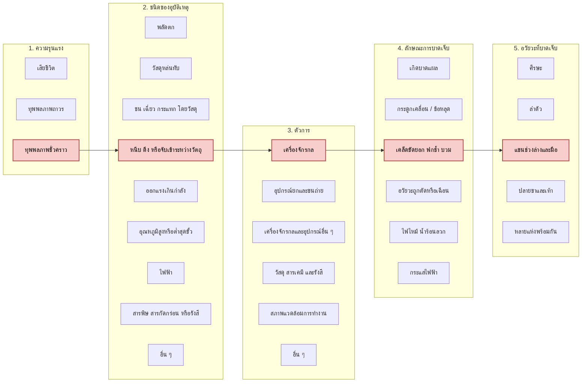
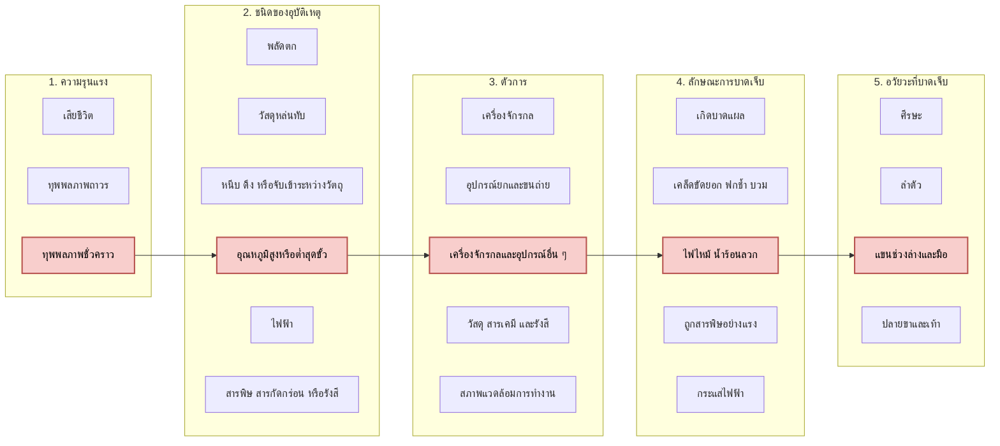
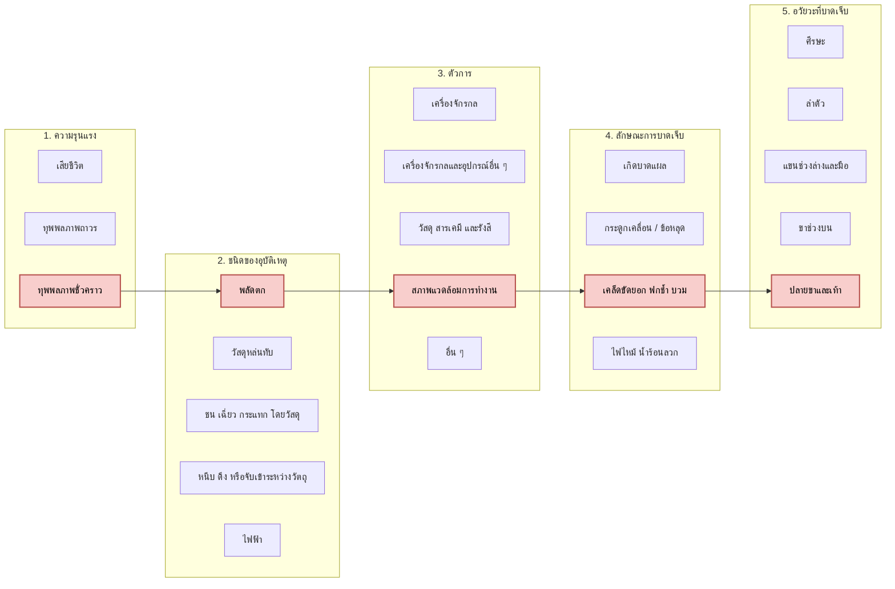

## กิจกรรมการเรียนรู้นอกห้องเรียน 
ในงาน KMITL INNOVATION EXPO 2026 ซึ่งจัดขึ้นภายในสถาบันพระจอมเกล้าเจ้าคุณทหารลาดกระบัง
ให้นักศึกษาออกไปสำรวจประเด็นความปลอดภัยในการจัดแสดงนิทรรศการของบูธต่างๆ โดยใช้การจำแนกประเภทและสถิติอุบัติเหตุจากการทำงานตามมาตรฐานของ ILO ตามภาพที่กำหนดให้ 
![[ILO Classification_example.svg]]

ให้นักศึกษาทำเอกสารสรุปอย่างน้อย 3 บูธ ใน 3 พื้นที่จัดแสดง โดยอธิบายเหมือนในตัวอย่าง และระบายสีในกล่องและลากลูกศรเหมือนในตัวอย่าง พร้อมทั้งแนบรูปถ่ายบรรยากาศมาด้วย

**ตัวอย่าง**
ที่บูธของภาควิชาครุศาสตร์วิศวกรรม คณะครุศาสตร์อุตสาหกรรมและเทคโนโลยี ได้มีการจัดวางรถหุ่นยนต์ไว้บนขารองซึ่งสูงจากพื้นมากกว่า 30 เซนติเมตร โดยไม่มีการขึงเชือกกั้น มีความเสี่ยงที่ผู้เข้าชม จะเดินไปเฉียดและตกกระแทก 

ความรุนแรงถ้าเกิดอุบัติเหตุคือทำให้ตัวหุ่นยนต์ตกกระแทกหลังเท้า และเนื่องจากผู้เข้าชมเป็นนักเรียนระดับมัธยม ไม่ได้ใส่รองเท้านิรภัย อาจจะทำให้เกิดเท้าแตกได้ อาจจะต้องหยุดเรียนเป็นช่วงเวลาหนึ่ง แต่ไม่ถึงขั้นเสียชีวิต

![[engedu.svg]]

---

## รายงานผลการสำรวจความปลอดภัยในงาน KMITL INNOVATION EXPO 2026
**ชื่อ-นามสกุล:** นายพีรพัฒน์ (รหัสนักศึกษา: `69030188`)  
**รายวิชา:** `03376117 OCCUPATIONAL HEALTH AND SAFETY`

---

### บูธที่ 1: บูธจัดแสดงแขนกลหุ่นยนต์อุตสาหกรรมอัตโนมัติ (Robotic Arm)
- **หน่วยงาน/คณะ:** คณะวิศวกรรมศาสตร์ (สาขาวิชาวิศวกรรมระบบควบคุมและเครื่องมือวัด / วิศวกรรมหุ่นยนต์)
- **พื้นที่จัดแสดงที่ 1:** โซนหอประชุมเจ้าพระยาสุรวงษ์ไวยวัฒน์ (หอประชุมใหญ่ KMITL)

#### 1. รายละเอียดการสำรวจประเด็นความเสี่ยงและความรุนแรง
ที่บูธจัดแสดงแขนกลหุ่นยนต์อุตสาหกรรม คณะวิศวกรรมศาสตร์ บริเวณโซนหอประชุมเจ้าพระยาสุรวงษ์ไวยวัฒน์ ได้มีการเปิดเดินเครื่องสาธิตการหมุนและหยิบจับชิ้นงานของแขนกลขนาดเล็กบนโต๊ะจัดแสดงที่มีความสูงระดับเอว โดยไม่มีการติดตั้งฉากอะคริลิกใสกั้นรอบรัศมีการเหวี่ยงของแขนกล และไม่มีปุ่มหยุดฉุกเฉิน (Emergency Stop) วางไว้ในจุดที่เจ้าหน้าที่คุมบูธเอื้อมกดได้ทันที มีความเสี่ยงที่ผู้เข้าชมซึ่งยืนมุงดูในระยะประชิดจะยื่นมือเข้าไปสัมผัสหรือถูกข้อต่อของแขนกลที่กำลังเคลื่อนที่เหวี่ยงมากระแทกและหนีบได้

ความรุนแรงถ้าเกิดอุบัติเหตุคือ ทำให้แขนกลเหวี่ยงกระแทกหรือหนีบบริเวณมือและนิ้วของผู้เข้าชม จนเกิดอาการฟกช้ำ บวม หรือนิ้วเคล็ดขัดยอก ต้องเข้ารับการปฐมพยาบาลและพักการเรียนหรือการทำงานชั่วคราว แต่ไม่ถึงขั้นพิการถาวรหรือเสียชีวิต

#### 2. รูปถ่ายบรรยากาศประจำบูธที่ 1
> *(นำไฟล์ภาพถ่ายบรรยากาศของบูธที่ 1 มาใส่ในโฟลเดอร์ `Week-08` แล้วตั้งชื่อว่า `booth1_photo.jpg`)*
![[booth1_photo.jpg]]

#### 3. การจำแนกประเภทอุบัติเหตุตามมาตรฐาน ILO (5 มิติ) — บูธที่ 1
- **ความรุนแรงของอุบัติเหตุ:** `ทุพพลภาพชั่วคราว`
- **ชนิดของอุบัติเหตุ (Type):** `หนีบ ดึง หรือจับเข้าระหว่างวัตถุ`
- **ตัวการ (Agency):** `เครื่องจักรกล`
- **ลักษณะการบาดเจ็บ (Nature):** `เคล็ดขัดยอก ฟกช้ำ บวม`
- **อวัยวะที่บาดเจ็บ (Location):** `แขนช่วงล่างและมือ`

![[booth1_ilo.svg]]

---

### บูธที่ 2: บูธสาธิตเครื่องพิมพ์ 3 มิติและเครื่องตัดเลเซอร์ขนาดเล็ก (3D Printer & Mini Laser Engraver)
- **หน่วยงาน/คณะ:** คณะสถาปัตยกรรม ศิลปะและการออกแบบ (สาขาวิชาการออกแบบอุตสาหกรรม / นวัตกรรมการออกแบบ)
- **พื้นที่จัดแสดงที่ 2:** โซนอาคารเรียนรวมสมเด็จพระเทพฯ (โถงนิทรรศการชั้น 1)

#### 1. รายละเอียดการสำรวจประเด็นความเสี่ยงและความรุนแรง
ที่บูธจัดแสดงผลงานการขึ้นรูปชิ้นงานต้นแบบด้วยเครื่องพิมพ์ 3 มิติ (3D Printer) ของคณะสถาปัตยกรรม ศิลปะและการออกแบบ บริเวณโถงอาคารเรียนรวมสมเด็จพระเทพฯ ได้มีการเปิดเครื่องพิมพ์ 3 มิติแบบเปลือยโครงสร้าง (Open-frame) ซึ่งหัวฉีดพลาสติก (Nozzle) มีอุณหภูมิสูงถึง 200–220 องศาเซลเซียส และฐานทำความร้อน (Heated Bed) มีอุณหภูมิประมาณ 60–80 องศาเซลเซียส วางอยู่ริมขอบโต๊ะด้านหน้าเพื่อให้ผู้เข้าชมเห็นการฉีดเส้นพลาสติกอย่างใกล้ชิด โดยไม่มีป้ายเตือนความร้อนและไม่มีฝาครอบป้องกัน มีความเสี่ยงที่ผู้เข้าชมซึ่งยื่นมือเข้าไปจับดูชิ้นงานที่เพิ่งพิมพ์เสร็จจะเผลอไปสัมผัสโดนหัวฉีดความร้อนสูง

ความรุนแรงถ้าเกิดอุบัติเหตุคือ ทำให้ผิวหนังบริเวณนิ้วมือหรือหลังมือสัมผัสกับหัวฉีดความร้อนสูงจนเกิดแผลพุพองจากความร้อน (ไฟไหม้/ความร้อนลวก) ต้องได้รับการปฐมพยาบาลทายารักษาแผลพุพองและพักการใช้งานมือชั่วคราว แต่ไม่ถึงขั้นทุพพลภาพถาวรหรือเสียชีวิต

#### 2. รูปถ่ายบรรยากาศประจำบูธที่ 2
> *(นำไฟล์ภาพถ่ายบรรยากาศของบูธที่ 2 มาใส่ในโฟลเดอร์ `Week-08` แล้วตั้งชื่อว่า `booth2_photo.jpg`)*
![[booth2_photo.jpg]]

#### 3. การจำแนกประเภทอุบัติเหตุตามมาตรฐาน ILO (5 มิติ) — บูธที่ 2
- **ความรุนแรงของอุบัติเหตุ:** `ทุพพลภาพชั่วคราว`
- **ชนิดของอุบัติเหตุ (Type):** `อุณหภูมิสูงหรือต่ำสุดขั้ว`
- **ตัวการ (Agency):** `เครื่องจักรกลและอุปกรณ์อื่น ๆ`
- **ลักษณะการบาดเจ็บ (Nature):** `ไฟไหม้ น้ำร้อนลวก`
- **อวัยวะที่บาดเจ็บ (Location):** `แขนช่วงล่างและมือ`

![[booth2_ilo.svg]]

---

### บูธที่ 3: บูธจัดแสดงโดรนเพื่อการเกษตรและนวัตกรรมสมาร์ทฟาร์ม (Agricultural Drone)
- **หน่วยงาน/คณะ:** คณะเทคโนโลยีการเกษตร (ร่วมกับกลุ่มนวัตกรรมอากาศยานไร้คนขับ)
- **พื้นที่จัดแสดงที่ 3:** โซนลานนิทรรศการกลางแจ้ง / โซนนวัตกรรมเกษตรอัจฉริยะ

#### 1. รายละเอียดการสำรวจประเด็นความเสี่ยงและความรุนแรง
ที่บูธจัดแสดงโดรนพ่นปุ๋ยและสำรวจพื้นที่เกษตรกรรม บริเวณโซนนิทรรศการกลางแจ้ง ได้มีการลากสายไฟพ่วง (Extension Cord) ยาวจากจุดจ่ายไฟหลักตัดผ่านพื้นทางเดินเท้าหน้าบูธเพื่อจ่ายไฟให้กับจอโทรทัศน์นำเสนอผลงานและแท่นชาร์จแบตเตอรี่โดรน โดยไม่มีการใส่รางครอบสายไฟพาดพื้น (Cable Ramp) และไม่ได้ติดเทปตีเส้นสีเหลือง-ดำแจ้งเตือน มีความเสี่ยงสูงที่ผู้เข้าชมงานซึ่งเดินดูบอร์ดนิทรรศการพร้อมกับก้มดูโทรศัพท์มือถือจะเดินสะดุดสายไฟจนเสียหลักล้มกระแทกพื้นปูน

ความรุนแรงถ้าเกิดอุบัติเหตุคือ ทำให้ผู้เข้าชมเดินสะดุดสายไฟแล้วพลัดตกหกล้มในระดับเดียวกัน ข้อเท้าพลิกหรือหัวเข่ากระแทกพื้นปูนจนเกิดอาการเคล็ดขัดยอก ฟกช้ำ บวมบริเวณข้อเท้าและปลายขา ต้องหยุดพักรักษาตัวเป็นระยะเวลาหนึ่ง แต่ไม่ถึงขั้นเสียชีวิต

#### 2. รูปถ่ายบรรยากาศประจำบูธที่ 3
> *(นำไฟล์ภาพถ่ายบรรยากาศของบูธที่ 3 มาใส่ในโฟลเดอร์ `Week-08` แล้วตั้งชื่อว่า `booth3_photo.jpg`)*
![[booth3_photo.jpg]]

#### 3. การจำแนกประเภทอุบัติเหตุตามมาตรฐาน ILO (5 มิติ) — บูธที่ 3
- **ความรุนแรงของอุบัติเหตุ:** `ทุพพลภาพชั่วคราว`
- **ชนิดของอุบัติเหตุ (Type):** `พลัดตก`
- **ตัวการ (Agency):** `สภาพแวดล้อมการทำงาน`
- **ลักษณะการบาดเจ็บ (Nature):** `เคล็ดขัดยอก ฟกช้ำ บวม`
- **อวัยวะที่บาดเจ็บ (Location):** `ปลายขาและเท้า`

![[booth3_ilo.svg]]

---

## ตารางสรุปเปรียบเทียบการจำแนกอุบัติเหตุทั้ง 3 บูธ (มาตรฐาน ILO 5 มิติ)

| บูธที่ | พื้นที่จัดแสดง | 1. ความรุนแรง | 2. ชนิดของอุบัติเหตุ | 3. ตัวการ | 4. ลักษณะการบาดเจ็บ | 5. อวัยวะที่บาดเจ็บ | แนวทางแก้ไขป้องกันในงานนิทรรศการ |
| :---: | :--- | :--- | :--- | :--- | :--- | :--- | :--- |
| **1** | หอประชุมเจ้าพระยาสุรวงษ์ไวยวัฒน์ (บูธแขนกลหุ่นยนต์) | `ทุพพลภาพชั่วคราว` | `หนีบ ดึง หรือจับเข้าระหว่างวัตถุ` | `เครื่องจักรกล` | `เคล็ดขัดยอก ฟกช้ำ บวม` | `แขนช่วงล่างและมือ` | ติดตั้งฉากอะคริลิกใสกั้นรัศมีแขนกล และวางเสากั้นเขตห้ามยื่นมือ |
| **2** | อาคารเรียนรวมสมเด็จพระเทพฯ (บูธเครื่องพิมพ์ 3 มิติ) | `ทุพพลภาพชั่วคราว` | `อุณหภูมิสูงหรือต่ำสุดขั้ว` | `เครื่องจักรกลและอุปกรณ์อื่น ๆ` | `ไฟไหม้ น้ำร้อนลวก` | `แขนช่วงล่างและมือ` | ใช้ตู้ครอบอะคริลิกปิดรอบเครื่องพิมพ์ 3 มิติ และติดป้ายเตือนระวังความร้อนสูง |
| **3** | ลานนิทรรศการกลางแจ้ง (บูธโดรนเกษตร/สมาร์ทฟาร์ม) | `ทุพพลภาพชั่วคราว` | `พลัดตก` | `สภาพแวดล้อมการทำงาน` | `เคล็ดขัดยอก ฟกช้ำ บวม` | `ปลายขาและเท้า` | ติดตั้งรางครอบสายไฟพาดพื้น (Cable Ramp) สีเหลือง-ดำ หรือเดินสายไฟเลียบผนังแทนการพาดทางเดิน |
